<div align="center">

# Wardrobe

Your closet on the web, on iPhone and iPad, and on Android. Snap a photo, and the AI you pick (Claude, ChatGPT or Gemini) finds each piece, cuts it out, and styles outfits from what you own. Each morning, Home has an outfit ready, made on your phone.

[](CHANGELOG.md)
[](LICENSE)
[](package.json)
[](#pick-your-ai)
[](#icloud-closet-no-server)
[](docs/synology.md)

Based on [tandpfun/wardrobe](https://github.com/tandpfun/wardrobe) ([original post](https://x.com/cdngdev/status/2076812846793650485)).

</div>

<p align="center">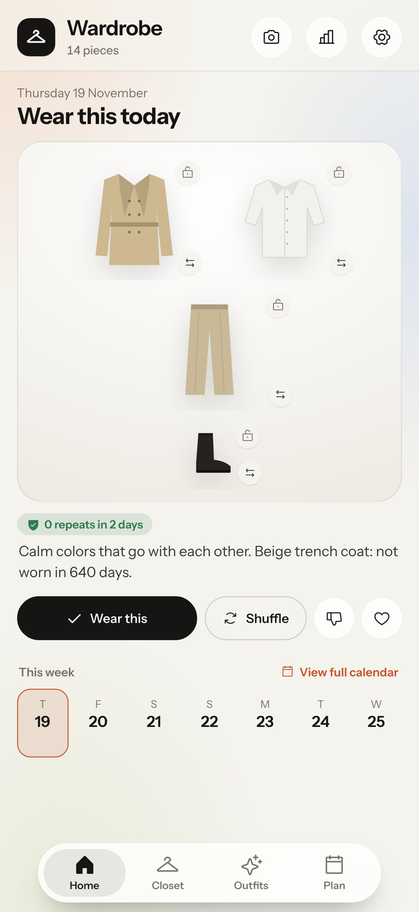 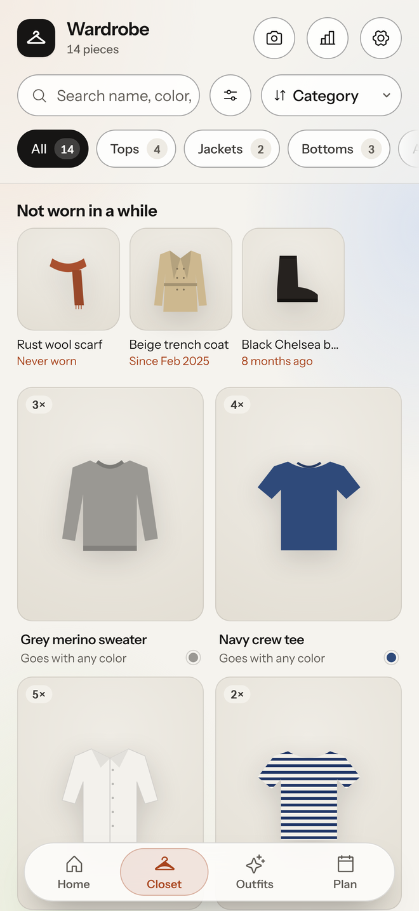 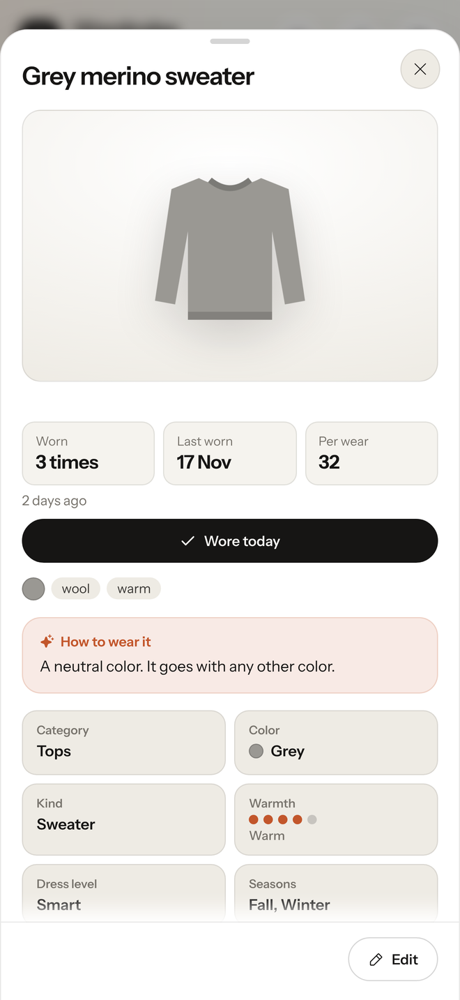 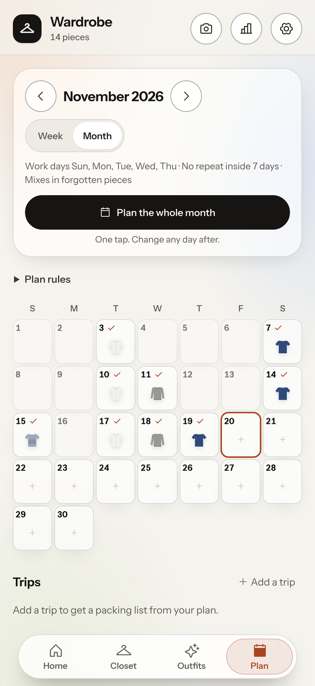</p>

<sub>Screenshots use a small drawn sample closet.</sub>

**[What's new](#whats-new-in-35)** ·
**[What it does](#what-it-does)** ·
**[Screenshots](#screenshots)** ·
**[Quick start](#quick-start-on-your-computer)** ·
**[Pick your AI](#pick-your-ai)** ·
**[Synology NAS](#run-it-on-your-synology-nas-docker)** ·
**[Cloudflare](#run-it-on-cloudflare)** ·
**[iPhone app](#iphone-app)** ·
**[Android app](#android-app)** ·
**[App stores](#releasing-to-the-app-stores)** ·
**[Settings](#settings)**

## What's new in 3.5

Everything since 3.0, in short. See the [changelog](CHANGELOG.md) for every change.

- **Home.** The app opens on an outfit for today, laid out as worn, with a line that says why it works. Lock the pieces you like and shuffle the rest, swap one piece, say "Not me", or keep it with the heart. A strip shows the next seven days with the weather.
- **Outfits with no AI.** The phone puts outfits together by itself from the color wheel, the weather, how dressy each piece is and how long it has rested. No key, no cost, and it works offline.
- **Home Screen widget** on iPhone with today's outfit, in small and medium sizes.
- **A page for each piece.** How often you wore it, cost per wear, a short note on how to wear it, and pieces from your closet that go well with it.
- **Plan.** Past days show what you wore. Give a day an occasion (Work, Casual, Dinner or Formal), pin a day so it stays, and set how long a piece rests after a wear.
- **Your closet in numbers.** Pieces worn in 60 days, closet value, cost per wear, colors, most worn and not worn lately.
- **Modest wear.** Abaya, thobe, hijab, shemagh and bisht, with their Arabic names, and outfits that pair them.
- **Easier imports.** The system photo picker on iPhone, a queue that carries on after you close the app, "Try again" for failed photos, and "Add all to my closet".
- **Feel and look.** Taps you can feel on iPhone, Light, Dark or Auto, seven accent colors, wind and rain in the forecast.
- **Safer and faster.** A smaller first load, and a protected server that only answers the apps and the sites you name.

**A full check of the app.** A review of the whole app fixed more than 200 small things:

- **Screens.** Dialogs close with Escape and keep the keyboard inside them. Home shows a loading state, can undo "Not me", and can go back to the planned look. The outfit builder has search, and deleting an outfit asks first.
- **Look.** Higher contrast, larger tap targets, Dark mode that follows your Light or Dark choice, and right to left fixes for Arabic, with the right plural forms.
- **Server and Worker.** Safer file paths, security headers, AI calls that time out and try again, and a plan that keeps what you removed when two copies meet. The plan now goes along when you copy a closet to Cloudflare.
- **Phone apps.** On iPhone the app waits for iCloud files before it reads them. On Android, backups leave out your token and private files.
- **Web app.** Add it to your Home Screen from the browser, and it opens even when the connection drops.

## What was new in 3.0

- **No server needed on iPhone and iPad.** Pick **Use iCloud** on the first screen and your closet lives in your own iCloud, synced across your Apple devices. Nothing goes to us.
- **The AI is called from your phone** with the key you paste, kept in the Keychain.
- **Move an existing closet** from your server to iCloud in Settings. The server keeps its copy.

<details>
<summary>Older versions (2.1 to 2.6)</summary>

- **2.6:** the whole app in Arabic, right to left. Weather for the day. Basics you add with no photo. Clean cutouts on iPhone and a Fix edges brush.
- **2.5:** the Plan tab fills a month with outfits in one tap, with packing lists for trips. Pieces sort themselves into groups such as Winter, Work and Neutrals. A see-through glass look.
- **2.4:** a Today card, a row of clothes you have not worn in 60 days, a wear log with cost per wear, and outfits built on the color wheel with a score.
- **2.3:** the Android app, a bottom tab bar on phones, a clear first run, a yes before any photo goes to an AI, safer image links, and one-button releases to TestFlight and Google Play.
- **2.2:** pick Claude, ChatGPT or Gemini in Settings and paste its key there.
- **2.1:** build outfits yourself, edit and filter outfits, filter by color, a new look with dark mode, and a Synology NAS guide.

</details>

## What it does

- **An outfit for today.** Home picks one from your closet each day, and you can lock, shuffle or swap pieces until it feels right.
- **Plan the week or month.** One tap fills the days, with no repeats inside a week, an occasion per day and a packing list for trips.
- **Know your closet.** A wear log, cost per wear, clothes you have not worn lately, and your closet in numbers.
- **Add clothes from a photo.** Drop, paste, choose or take a picture of one piece or a whole outfit. The AI finds every garment and suggests a name, category, colors and tags.
- **Clean cutouts.** Each piece is cut out of the real photo with background removal, so it looks like your actual item. You check the crop and the cutout before anything is saved.
- **Style outfits.** Press **Style new outfits** and the AI builds looks from your closet, names them, and says why they work. Add a note like "cool weekend in the city", or tap an idea such as "Dinner out", to steer it.
- **Build your own outfits.** Press **Build your own**, pick two or more pieces, and save the look. Edit any outfit's name, occasions and note later, and filter outfits by occasion.
- **Edit and sort.** Filter by tops, jackets, bottoms, accessories and shoes. Change names, colors and tags at any time.
- **Search, filter and sort.** Find pieces by name, tag, category or color word, filter by color or group, and sort by category, newest, color or name.
- **Light and dark.** A clean, modern look in Light, Dark or Auto, with an accent color you pick, on desktop and phone.
- **iCloud or your own server.** On iPhone and iPad, keep the closet in your own iCloud with no server. Or run it as a container on your Synology NAS (or any Docker host) so all photos and data stay at home, or on Cloudflare. The web app, phone browsers and the iPhone, iPad and Android apps share one closet.

## Screenshots

**On the phone.** Home with today's outfit, the closet, a piece, saved outfits, one outfit, and the month plan.

<p>  </p>
<p>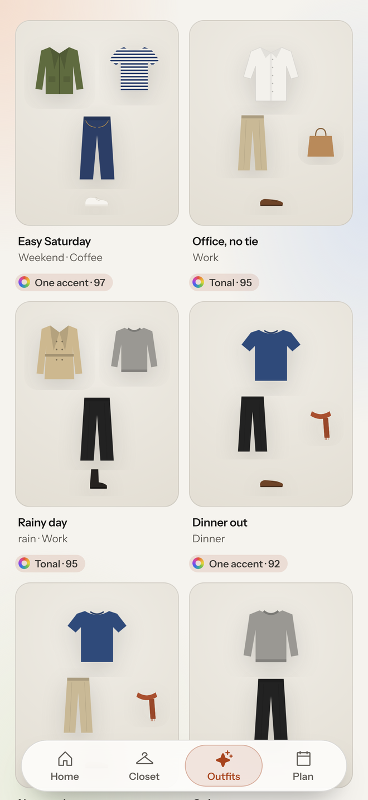 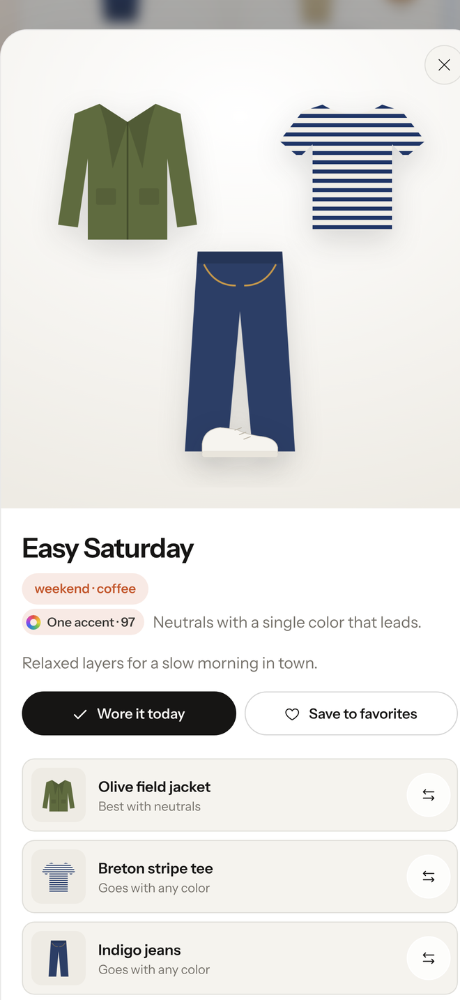 </p>

**On a computer.** Home in light and dark, the closet, and your closet in numbers.

| Home | Home in dark |
| --- | --- |
| 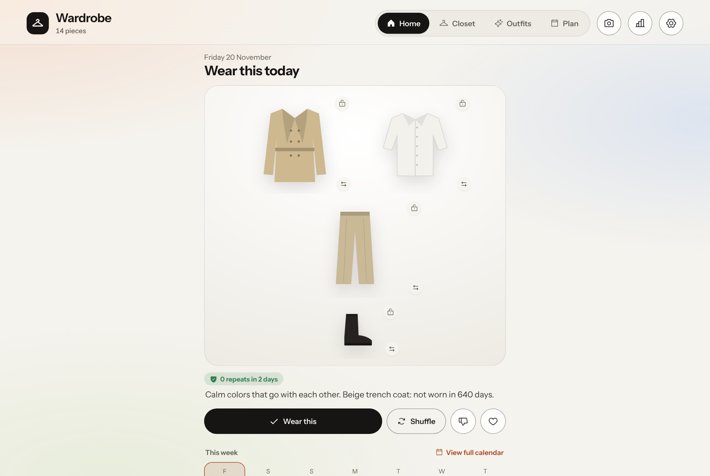 | 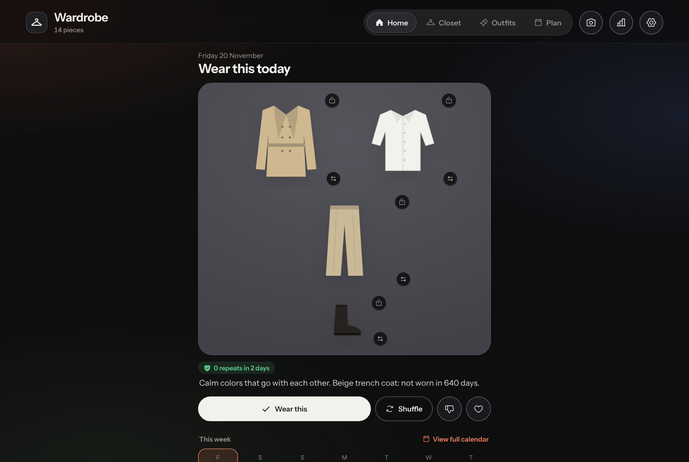 |

| Closet | Your closet in numbers |
| --- | --- |
| 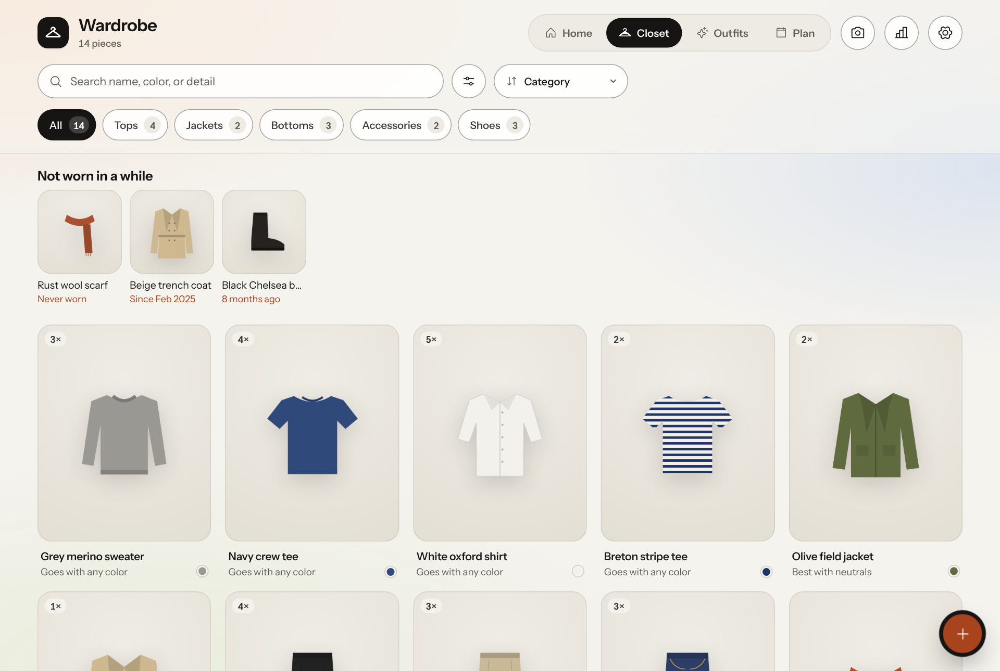 | 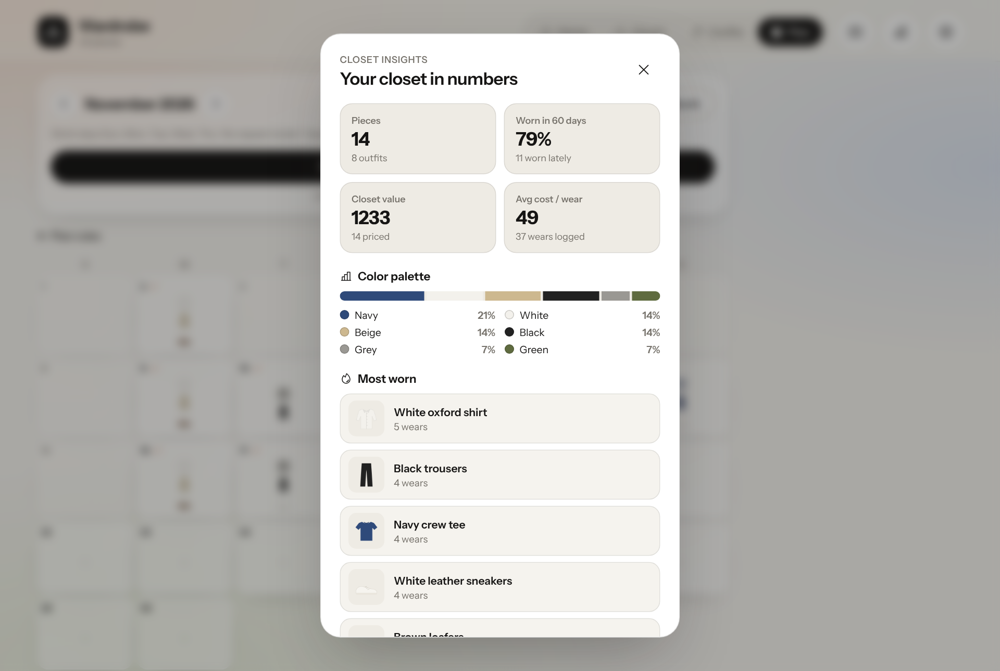 |

**Review before saving.** After the AI finds a piece and the background is removed, you check the details, then approve, reject, or keep the background.

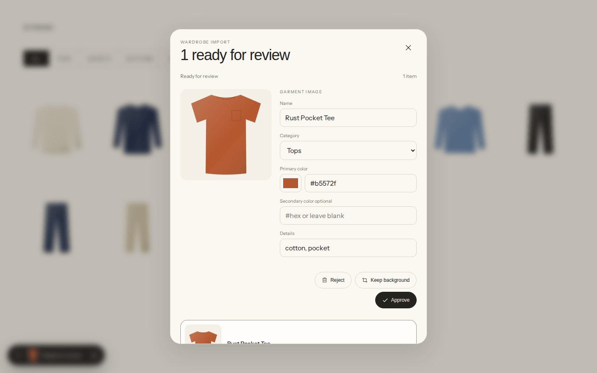

**A real closet** from the original project:

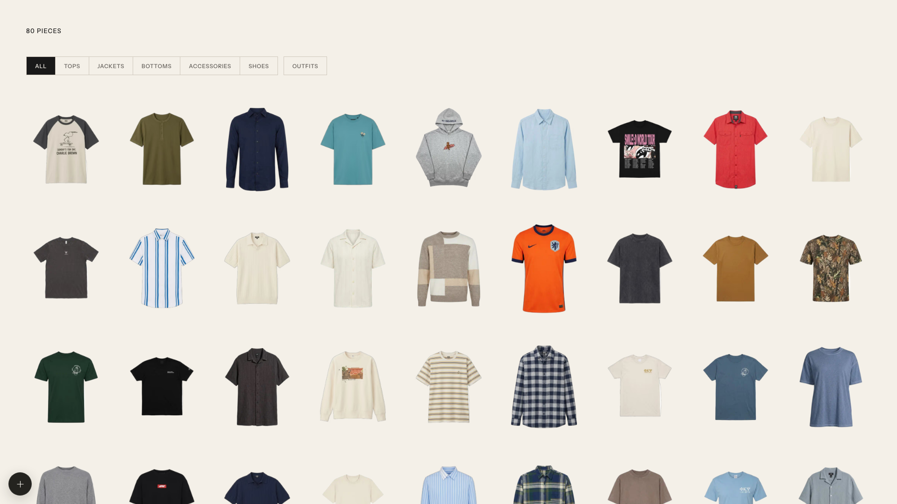

## Quick start (on your computer)

You need Node 22 or newer and an API key for Claude, ChatGPT or Gemini (see [Pick your AI](#pick-your-ai)).

```bash
git clone https://github.com/njarrar/wardrobe-web-ios.git
cd wardrobe-web-ios
npm install
cp .env.example .env
npm run dev              # http://localhost:5173
```

Open the gear icon, pick an AI and paste its key. You can also put the key in `.env` instead (see [Settings](#settings)).

To run the built app instead:

```bash
npm run build
npm start                # http://localhost:4173
```

On your computer, garments are cut out by a small open model ([BiRefNet lite](https://huggingface.co/onnx-community/BiRefNet_lite)) through `@huggingface/transformers`. `npm install` adds it when it can, and the model downloads (about 200 MB) the first time you import. If it is missing, the app lets you keep the crop with its background.

### Use it from your phone on the same Wi-Fi

The server only listens on your computer by default. To open it from your phone, set both of these in `.env` and restart:

```bash
WARDROBE_HOST=0.0.0.0
WARDROBE_TOKEN=pick-a-long-random-string
```

The server refuses to listen on your network without a token. The browser and the app ask for it once and remember it.

## Run it on your Synology NAS (Docker)

The app ships as a single container. All data (closet, photos, cutouts, outfits, the cutout model cache) lives in one folder you mount at `/data`, so it sits on your NAS and is covered by your normal backups.

```bash
cp .env.example .env     # set a long WARDROBE_TOKEN (and an AI key, or add it in the app later)
docker compose up -d --build
# open http://<nas-ip>:4173 and enter your token
```

On DSM 7.2+, use **Container Manager → Project → Create**, point it at this folder and it picks up `docker-compose.yml`. Set `PUID`/`PGID` to your DSM user (`id` over SSH) so files in `./data` belong to you. The GitHub workflow in `.github/workflows/docker.yml` also publishes a multi-arch image (amd64 + arm64) to GHCR if you prefer pulling an image.

For the iPhone app away from home, put the NAS behind HTTPS with the DSM reverse proxy (plus DDNS and Let's Encrypt) or use Tailscale. QuickConnect can't relay the app's port.

The container starts as root only long enough to give `/data` to `PUID`/`PGID`, then runs as that user. If `./data` already belongs to your user, set `user:` in `docker-compose.yml` to run as that user from the start.

Step-by-step guide, reverse proxy, backups and troubleshooting: **[docs/synology.md](docs/synology.md)**.

Health check (no token needed): `GET /api/health` answers `{ ok, version, protected }`. It works the same with `npm start`, `npm run dev` and on Cloudflare.

## Run it on Cloudflare

Put your closet online so it is the same on every device. Photos and cutouts go in R2, your closet and outfits go in D1, and cutouts run from a Queue.

You need:

- A Cloudflare account on the **Workers Paid** plan ($5 a month). Queues need it, and framing each garment image takes more CPU time than the free plan allows.
- Cloudflare Images turned on (Images, then Transformations, in the dashboard). It removes backgrounds; 5,000 cutouts a month are free.
- An API key for Claude, ChatGPT or Gemini.

One-time setup:

```bash
npx wrangler login
npx wrangler r2 bucket create wardrobe
npx wrangler d1 create wardrobe        # copy the database_id it prints into wrangler.jsonc
npx wrangler queues create wardrobe-jobs
npm run cf:migrate                     # creates the tables
npx wrangler secret put WARDROBE_TOKEN # pick a long random string
npm run cf:deploy
```

Open the `workers.dev` address it prints, enter your token, then pick an AI and paste its key under the gear icon. (Worker secrets such as `ANTHROPIC_API_KEY` still work if you prefer them.) To copy a closet you built on your computer:

```bash
WARDROBE_TOKEN=your-token npm run cf:upload -- https://wardrobe.your-name.workers.dev
```

Run `npm run cf:migrate` and `npm run cf:deploy` again after each update (2.2 adds a `settings` table). To try the Worker on your computer first, put `WARDROBE_TOKEN` in `.dev.vars`, run `npx wrangler d1 migrations apply wardrobe --local`, then `npm run cf:dev`. Local Cloudflare Images can resize but not remove backgrounds, so cutouts keep their background there.

## Pick your AI

Open the gear icon, then under **AI** pick **Claude**, **ChatGPT** or **Gemini**, paste its API key and press **Save**. The pick and the key apply to every device that uses this server, including the iPhone app. You can also change the model, or leave it empty for the default.

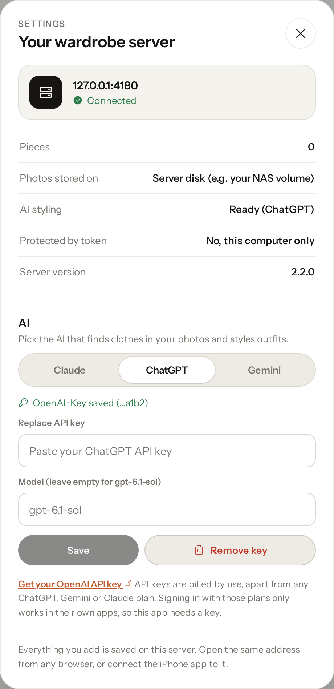

| AI | Get a key | Default model |
| --- | --- | --- |
| Claude (Anthropic) | [console.anthropic.com](https://console.anthropic.com/settings/keys) | `claude-opus-5` |
| ChatGPT (OpenAI) | [platform.openai.com](https://platform.openai.com/api-keys) | `gpt-6.1-sol` |
| Gemini (Google) | [aistudio.google.com](https://aistudio.google.com/apikey) | `gemini-3.8-flash` |

**Why a key and not a login?** A ChatGPT Plus, Gemini or Claude plan lets you sign in to that company's own apps, but none of them lets other apps use the plan. Apps like this one need an API key, which is billed by use on its own account. A few dollars of credit goes a long way here.

**Where the key is kept.** On your computer or NAS it goes in `data/settings.json`, which only the server's user can read. On Cloudflare it goes in your D1 database. The app never sends a whole key back to the browser; Settings shows only its last four characters. A key in `.env` (or a Worker secret) still works, and a key saved in the app takes its place until you remove it. Anyone with your `WARDROBE_TOKEN` can change the keys, so keep the token private.

## iPhone app

The `ios/` folder holds a Capacitor app that shows the same closet. Point it at your NAS container (e.g. `http://192.168.1.20:4173` at home, or your HTTPS reverse-proxy / Tailscale address anywhere), your Cloudflare Worker, or the server on your computer (set `WARDROBE_HOST` and `WARDROBE_TOKEN` first, see above).

You need a Mac with Xcode 26 or newer (the App Store needs the iOS 26 SDK):

```bash
npm install
npm run ios        # builds the web app, copies it into ios/, opens Xcode
```

In Xcode, pick your team under Signing & Capabilities, choose your iPhone, and press Run. On first launch the app asks for your server address and token, and tests the connection before saving it. Tap the gear icon later to see the connection status or switch servers. You can browse, edit, delete, add photos from your library or camera, and style outfits.

### iCloud closet (no server)

On iPhone and iPad you can skip the server: tap **Use iCloud** on the first screen. The app then keeps everything in its own hidden iCloud Drive folder (`iCloud.com.njarrar.wardrobe`), so the closet follows you to every device on the same Apple Account. AI keys go in the Keychain (synced by iCloud Keychain), and the app calls the AI you picked straight from the phone. With iCloud Drive off, the closet stays on that device. In **Settings > Where your closet lives** you can copy a server closet into iCloud, or go back to a server. Photo cutouts use Apple's on-device Vision (iOS 17 and later); on older iOS the crop is kept, and Fix edges can clean it up.

Before the first release with iCloud, turn on **iCloud** (with CloudKit off, iCloud Documents on) for `com.njarrar.wardrobe` in the Apple Developer site under Identifiers, and add the container `iCloud.com.njarrar.wardrobe`. The release workflow signs automatically and picks it up from there.

### Home Screen widget

The `WardrobeWidget` target shows today's outfit on the Home Screen, in small and medium sizes. The app writes the week's outfits to a shared App Group (`group.com.njarrar.wardrobe`), and the widget moves to the next day on its own. Before the first signed build, add that App Group in the Apple Developer site and turn it on for both `com.njarrar.wardrobe` and `com.njarrar.wardrobe.widget`.

On iPhone, **Choose images** opens Apple's photo picker, so the app needs no photo permission. Taps on Wear this, Shuffle, Lock, Swap, the heart and Pin day give a small buzz.

On any phone, the add button offers **Take photo** next to **Choose images**. Photos are turned upright and shrunk to 2048 px before upload.

## Android app

The `android/` folder holds the same Capacitor app for Android. It connects to your server the same way as the iPhone app, including plain `http://` addresses on home Wi-Fi.

You need Android Studio (or the Android SDK and Java 21):

```bash
npm install
npm run android    # builds the web app, copies it into android/, opens Android Studio
```

Pick a phone or emulator and press Run. To change the icon, edit the shirt in `scripts/make-android-icons.mjs` and run `node scripts/make-android-icons.mjs`.

## Releasing to the app stores

Publish a GitHub release and the **Release apps** workflow builds both phone apps and uploads them to TestFlight and the Google Play internal test track. The workflow needs signing keys stored as GitHub secrets; it names any that are missing. The **Store listing** workflow (run it by hand) fills in both store listings, with fresh screenshots, from a listing kept in the `STORE_LISTING_JSON` secret. The privacy policy is [docs/privacy.md](docs/privacy.md).

## Claude Code skills

Two skills in `.claude/skills` let [Claude Code](https://claude.com/claude-code) work on your closet without an API key, because Claude Code looks at your photos itself:

```text
/import-clothes Import the clothes from ~/Pictures/outfits and add them to this wardrobe.
/style-outfits Put together six outfits for autumn.
```

The import skill finds each garment, cuts it out, checks every cutout, then writes to `data/library.json` and `data/imported/`. The outfit skill looks at your pieces and adds looks to `data/outfits.json`.

## How it works

| Part | Where |
| --- | --- |
| Web app (React 19 + Vite) | `src/` (Home in `Home.jsx`, closet in `App.jsx` and `ClosetGrid.jsx`, a piece in `ItemViewer.jsx`, outfits in `Outfits.jsx`, plan in `Plan.jsx`, settings in `SettingsSheet.jsx`) |
| Outfits made on the phone, color wheel, plan, pairing | `shared/make-outfit.mjs`, `shared/style.mjs`, `shared/pairing.mjs` |
| iCloud closet with no server | `src/local/` |
| Local server and API | `scripts/import-job-api.mjs`, `scripts/serve.mjs` |
| Rules shared by the server and the Worker (item edits, outfits) | `shared/core.mjs` |
| Cloudflare Worker (R2, D1, Queue, Images) | `worker/`, `wrangler.jsonc` |
| AI calls for Claude, ChatGPT and Gemini (finding clothes, styling outfits) | `shared/ai.mjs` |
| AI picker in Settings | `src/AiSettings.jsx` |
| iPhone app (Capacitor), widget and native plugins | `ios/` (`WardrobeWidget/`, `App/NativeExtras.swift`, `App/PhotoPicker.swift`) |
| Android app (Capacitor) | `android/` |
| Docker image and Synology setup | `Dockerfile`, `docker/`, `docker-compose.yml`, `docs/synology.md` |
| Image publishing (GHCR, amd64 + arm64) | `.github/workflows/docker.yml` |
| Claude Code skills | `.claude/skills/` |

All three AIs answer in structured JSON against the same schema. Claude calls use `claude-opus-5`, and if Claude declines to read a photo the API retries on the model Anthropic recommends (`fallbacks: "default"`). ChatGPT calls use OpenAI Chat Completions with a strict JSON schema; Gemini calls use `generateContent` with a JSON response schema. Both go through plain `fetch`, so they run the same on Node and on Cloudflare.

Your photos and closet stay in `data/` on your computer (or in your own R2 and D1 on Cloudflare). `data/` is never committed.

## Settings

| Variable | Default |
| --- | --- |
| `WARDROBE_AI_PROVIDER` | `claude`, `openai` or `gemini`. Used until you pick one in the app; otherwise the first AI with a key |
| `ANTHROPIC_API_KEY` | Claude key (or add it in the app) |
| `OPENAI_API_KEY` | ChatGPT key (or add it in the app) |
| `GEMINI_API_KEY` | Gemini key (or add it in the app) |
| `WARDROBE_CLAUDE_MODEL` | `claude-opus-5` |
| `WARDROBE_OPENAI_MODEL` | `gpt-6.1-sol` |
| `WARDROBE_GEMINI_MODEL` | `gemini-3.8-flash` |
| `WARDROBE_CUTOUT_MODEL` | `onnx-community/BiRefNet_lite` (computer only) |
| `WARDROBE_DATA_DIR` | `data` |
| `WARDROBE_HOST` | `127.0.0.1` |
| `WARDROBE_TOKEN` | Required when `WARDROBE_HOST` is not local, and on Cloudflare |
| `WARDROBE_CORS_ORIGINS` | Other web addresses, comma separated, that may call a protected server from a browser |
| `PORT` | `4173` (for `npm start`) |
| `PUID` / `PGID` | `1026` / `100` (Docker only: owner of files in `./data`) |
| `TZ` | `Europe/London` (Docker only) |
| `WITH_CUTOUT` | `true` (Docker build arg; `false` = smaller image without on-device cutouts) |

## Tests

```bash
npm test           # API and image tests, with a stand-in for the Claude, OpenAI and Gemini APIs
npm run check      # build, test, and check the iOS app has the same version
npm run test:ui    # open the built app on a phone-sized screen (needs Playwright's Chromium)
npm version 3.5.0  # bump the version everywhere, including the iOS app
```

## Changelog

See [CHANGELOG.md](CHANGELOG.md). Publishing your own copy: [docs/github.md](docs/github.md).

## License

[MIT](LICENSE)
